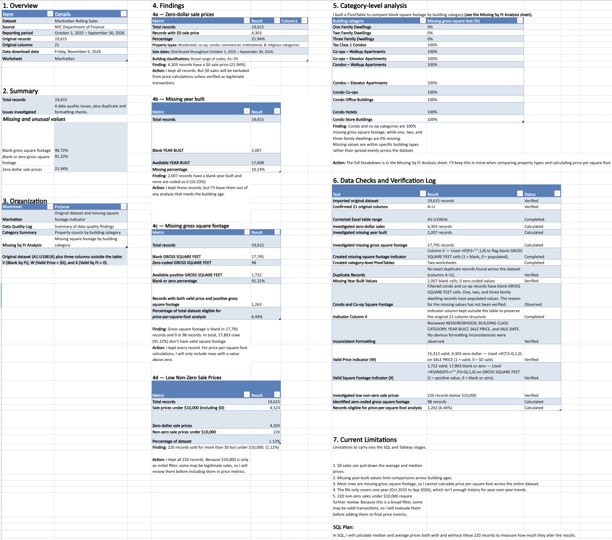

# Manhattan Real Estate Sales Analysis

This project looks at Manhattan property sales from the NYC Department of Finance, using Excel for cleaning, SQL for analysis, and Tableau for the final dashboard.

Status: Phase 1 Complete (Moving to Phase 2: SQL Analysis)

## Questions
1. Which Manhattan neighborhoods have the most recorded property sales?
2. How do sale prices differ by neighborhood and building type? Where can price per square foot actually be calculated?

## Why This Project?
Real estate decisions depend on knowing where sales are happening and what properties actually sell for. Manhattan's public sales data has a lot of gaps that affect which comparisons are fair. I wanted to practice the full process a data analyst would follow: check the data quality first, then analyze sales volume and prices by neighborhood and building type, then present the results in a dashboard.

## Dataset
- Source: [NYC Department of Finance Rolling Sales Data](https://nyc.gov)
- Period: October 1, 2025 to September 30, 2026
- Records: 19,615 raw records, 21 original columns (plus 3 indicator columns in V–X)
- Cleaned records: 19,615 flagged records exported for SQL analysis
- Downloaded: November 6, 2026

## Tools
- Excel: data cleaning, quality checks, initial exploration
- SQL: sales volume and price analysis
- Tableau: dashboard

## Progress

### Phase 1: Excel cleaning and exploration (completed)
The workbook has four sheets: the original data with indicator flags (Manhattan), a Data Quality Log, a Category Summary, and a Missing Sq Ft Analysis.

What I did in Phase 1:
- imported all 19,615 records, confirmed the 21 original columns (A–U), and fixed the Excel table range to A1:U19616
- investigated 4 data quality issues ($0 sale prices, missing year built, blank or zero gross square footage, and low non-zero sales under $10,000)
- checked for exact duplicates across columns A–U (none found) and confirmed missing year built values are blank cells, not zeros
- reviewed key columns for formatting inconsistencies (none found)
- added three indicator columns outside the table so I could keep all 19,615 rows intact for SQL filtering:
  - Column V (Blank Sq Ft): `=IF(P2="",1,0)`
  - Column W (Valid Price > $0): `=IF(T2>0,1,0)`
  - Column X (Valid Sq Ft > 0): `=IF(AND(P2<>"",P2>0),1,0)`
- built PivotTables showing property counts and missing square footage by building category
- exported the flagged sheet to `data/cleaned/` to get ready for SQL

### Phase 2: SQL analysis (upcoming)
Sales volume by neighborhood, average and median sale price by neighborhood (testing with and without the 220 sales under $10,000), sales by building type, and price per square foot for the 1,263 records with a valid price and size.

### Phase 3: Tableau dashboard (upcoming)
A dashboard showing sales volume by neighborhood, price comparisons that can be filtered by building type, and which building types have usable square footage data.

## Preliminary Findings

| Issue | Records | Share of dataset |
|---|---|---|
| $0 sale price | 4,303 | 21.94% |
| Missing year built | 2,007 | 10.23% |
| Blank gross square feet | 17,795 | 90.72% |
| Zero-coded gross square feet | 98 | 0.50% |
| Non-zero sales under $10,000 | 220 | 1.12% |
| Eligible for Price/Sq Ft | 1,263 | 6.44% |

Missing square footage is concentrated in specific building types rather than spread evenly across the file. In my PivotTable, one-, two-, and three-family dwellings have square footage for every record (0% missing), while categories like Condos – Elevator Apartments, Co-ops – Elevator Apartments, and Condo Co-ops are missing it 100% of the time. This limits price per square foot analysis for those property types.

About one in five records (4,303 rows) has a $0 sale price. The public file doesn't show why a property transferred for $0, so I kept all rows in the dataset and flagged them (`W = 0`) to leave out of price calculations.

The full breakdown is in the Data Quality Log sheet of the workbook (`excel/manhattan_sales_analysis.xlsx`, download to view). More findings will be added as I finish each phase.

## Limitations
- The data covers 12 months of recorded sales, so it doesn't represent the whole market and can't support year-over-year trends.
- $0 sales (4,303) and sales under $10,000 (220) can pull down average and median prices. I will test how much those 220 low sales affect the numbers in SQL before deciding whether to filter them out.
- Price per square foot will only use the 1,263 records with a valid price and square footage, which leaves out condos and co-ops.
- Building age analysis will only include the 17,608 records that have a year built.

## Repository Structure
Use code with caution.
Manhattan-Real-Estate-Analysis/
├── README.md
├── data/
│   ├── raw/
│   └── cleaned/
├── excel/
├── sql/
├── tableau/
└── visuals/
