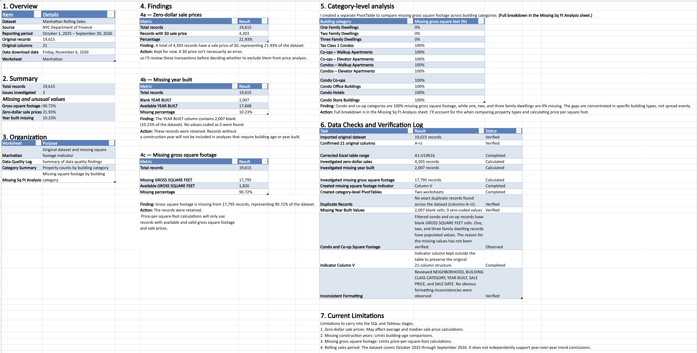

# Manhattan Real Estate Sales Analysis

This project looks at Manhattan property sales from the NYC Department of Finance, using Excel for cleaning, SQL for analysis, and Tableau for the final dashboard.

**Status:** In progress Phase 1 of 3

## Questions

1. Which Manhattan neighborhoods have the most recorded property sales?
2. How do sale prices differ by neighborhood and building type? Where can price per square foot actually be calculated?

## Why This Project?

Real estate decisions depend on knowing where sales are happening and what properties actually sell for. Manhattan's public sales data has a lot of gaps that affect which comparisons are fair. I wanted to practice the full process a business analyst would follow: check the data quality first, then analyze sales volume and prices by neighborhood and building type, then present the results in a dashboard.

## Dataset

- **Source:** [NYC Department of Finance Rolling Sales Data](https://www.nyc.gov/site/finance/taxes/property-rolling-sales-data.page)
- **Period:** October 1, 2025 to September 30, 2026
- **Records:** 19,615 raw records, 21 columns
- **Cleaned records:** to be added after Phase 1
- **Downloaded:** November 6, 2026

## Tools

- **Excel:** data cleaning, quality checks, initial exploration
- **SQL:** sales volume and price analysis
- **Tableau:** dashboard

## Progress

### Phase 1: Excel cleaning and exploration (in progress)

The workbook has four sheets: the original data (Manhattan), a Data Quality Log, a Category Summary, and a Missing Sq Ft Analysis.

So far I have:
- imported all 19,615 records and confirmed the 21 original columns
- measured three data quality issues (see below)
- checked for duplicates (none found) and confirmed missing year built values are blank cells, not zeros
- reviewed key columns for formatting inconsistencies (none found)
- added an indicator column for missing square footage
- built PivotTables showing how missing square footage varies by building category

Still to do:

- investigate the $0 sales to see which ones are not market transactions
- create the cleaned dataset

### Phase 2: SQL analysis (upcoming)

Sales volume by neighborhood, average and median sale price by neighborhood, sales by building type, and price per square foot for records with a valid price and size.

### Phase 3: Tableau dashboard (upcoming)

A dashboard showing sales volume by neighborhood, price comparisons that can be filtered by building type, and which building types have usable square footage data.

## Preliminary Findings

| Issue | Records | Share of dataset |
|---|---|---|
| $0 sale price | 4,303 | 21.93% |
| Missing year built | 2,007 | 10.23% |
| Missing gross square feet | 17,795 | 90.72% |

Missing square footage is concentrated in specific building types. In my PivotTable, one, two, and three family dwellings have square footage for every record, while categories like Condos – Elevator Apartments, Co-ops – Elevator Apartments, and Condo Co-ops are missing it 100% of the time. This limits price per square foot analysis for those property types. I haven't verified why the data is missing yet.

About one in five records has a $0 sale price. I'm keeping them for now and will look at what kind of transactions they are before using them in any price calculations.


The full breakdown is in the Data Quality Log sheet of the workbook (`excel/manhattan_sales_analysis.xlsx`, download to view). 
More findings will be added as I finish each phase.




## Limitations

- The data covers 12 months of recorded sales, so it doesn't represent the whole market and can't support year-over-year trends.
- $0 sales and other non-market transfers may not reflect real market prices. I'll decide how to handle them before comparing prices.
- Price per square foot will only use records with a valid price and square footage, which leaves out most condos and co-ops.
- Building age analysis will only include records that have a year built.

## Repository Structure (planned)

```
Manhattan-Real-Estate-Analysis/
├── README.md
├── data/
│   ├── raw/
│   └── cleaned/
├── excel/
├── sql/
├── tableau/
└── visuals/
```
